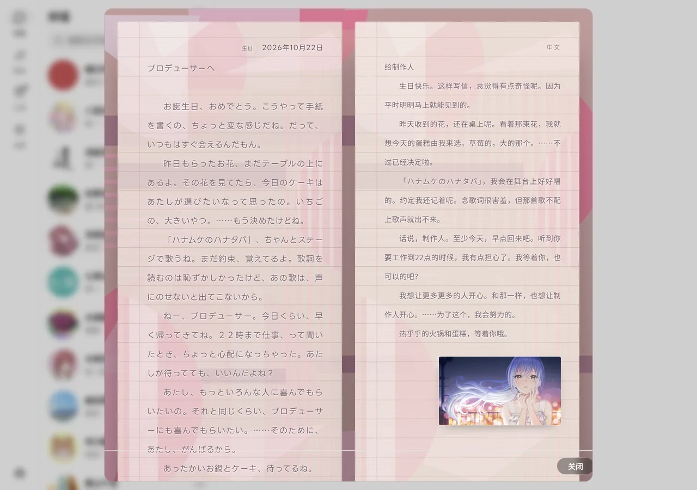
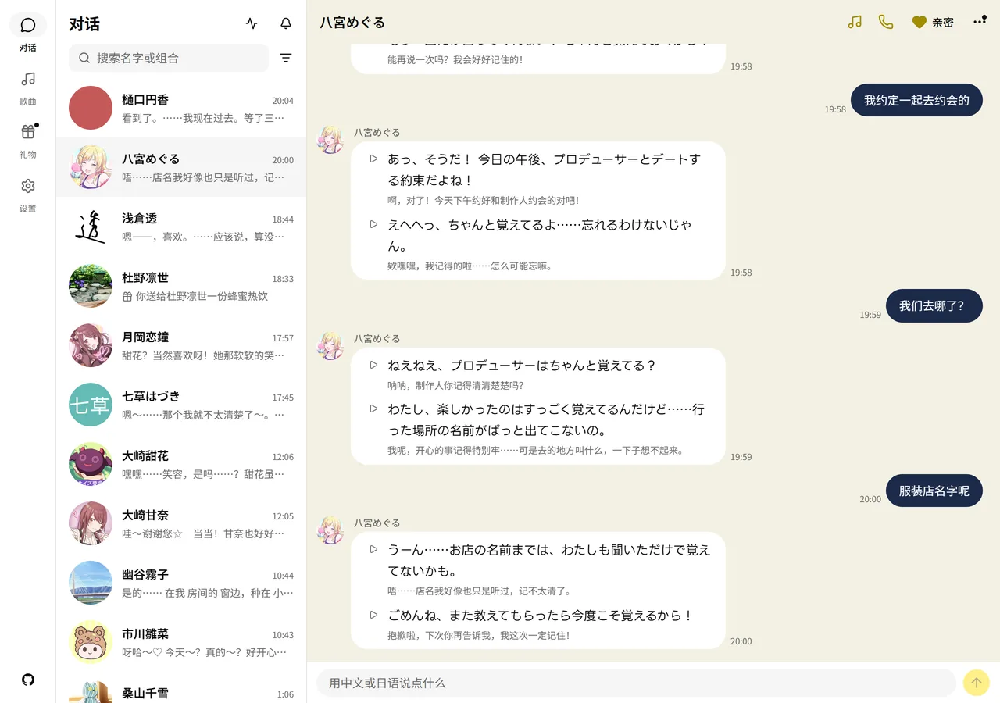
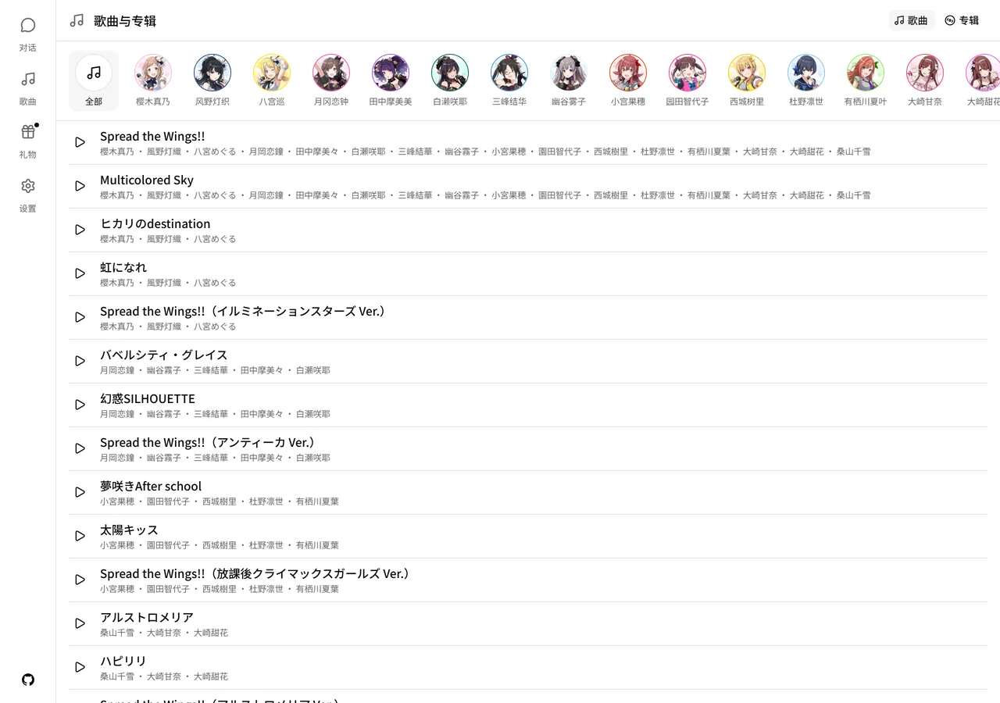

# 续・闪耀色彩

> 《偶像大师 闪耀色彩》的 AI 分身：文字 + 语音通话，28 位偶像加一位事务员。
> 非官方同人，AGPL-3.0-or-later。

仓库 `soulrewrite/eidolon-sc`，是 [Sallyn0225/eidolon-sc](https://github.com/Sallyn0225/eidolon-sc)
的 fork（上游不接 PR，所以单开一条线）。基线 `4b869539`，定向移植了上游的
成就系统（`44a3657e`）和七草はづき（`7eb50984`），其余都是自己加的。

## 加了什么

| 功能 | 一句话 |
| --- | --- |
| 消息语音 | 不打电话也能听她说：每句旁边的播放键 |
| 信 | 她会在晚上写一封信，有信封、卡面和手写签名 |
| 搭话 | 你不回她也会接着说；问句没人接，她会自己接上去 |
| 跨对话接续 | 换一段对话不再等于失忆，接得上上一段的最后 4 轮 |
| 歌曲 | 底部导航多了「歌曲」：曲目、专辑，点开就听 |

## 几个不显然的点

### 信：一张纸的两面

  

亲近以上才会写，每人每天最多一封——否则几个亲近角色会像刷屏。普通信在 18:00–22:00
之间抽一分钟送到，生日和每满 30 天当天就来。抬头和正文由她自己写：日文在原稿那页，
中文是同一张纸的第二面；她的卡面放在中文最后，签名压在纸脚。手机上是整屏的一页，
电脑上是并排的两张纸。

### 聊天界面

每条回复按句切开，日文下面跟中文字幕，每句都能单独播。跨对话接续只接**同一个角色**
上一段的最后 4 轮、且只接第一轮；检索不读它——把上一段原话塞进向量查询会把搜索带偏。

### 头像

对话列表、聊天记录、歌曲页用的都是各自 SCSP 的头像，不是从立绘裁出来的方图；
打电话时她背后仍是各自的场景画面。

### 歌曲

曲目和专辑来自世界设定，点开一首才去查它是哪首，再经**后端转发**官方直链播放——
那条直链是 http，页面直接引用会被浏览器拦掉；转发时透传 Range，进度条能拖。查到的进缓存，
查不到或没版权就照实说，不放别人的歌。

## 已知问题

- **信**：约定的检测（「下周带你去吃那家店」）还没做；信里也不能带照片。
- **语音和生图都依赖代理**：代理不通，这两个用不了；对话和文字不受影响。
- 不追上游每一次提交，也不改上游的领域模型（回合、搭话、记忆、好感度），除非先写进 `GLOSSARY.md`。
